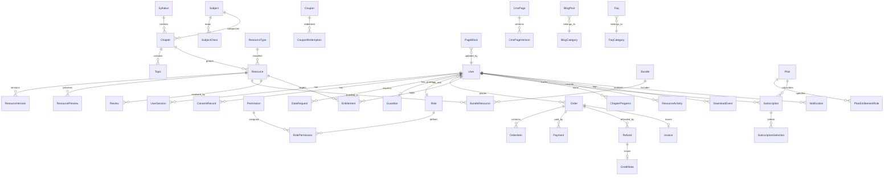

# EVOH Academy - Entity Relationship Diagram (ERD)

This document specifies the database architecture for EVOH Academy using PostgreSQL and Prisma ORM, as defined in **PRD v2.0 Section 18**.

---

## 1. High-Level Entity Relationship Diagram

---

## 2. Core Model Specifications

### 2.1 Identity & Authorization
- **`User`**: `id`, `authProviderId` (unique Supabase ID), `name`, `email` (unique), `phone`, `roleId`, `classPreference` (11 or 12), `dateOfBirth`, `status` (`ACTIVE`, `PENDING_GUARDIAN_CONSENT`, `SUSPENDED`), `emailVerifiedAt`, `createdAt`, `updatedAt`, `archivedAt`.
- **`Role`**: `id`, `name` (`SUPER_ADMIN`, `ADMIN`, `EDITOR`, `SUPPORT`, `STUDENT`, `GUARDIAN`), `description`.
- **`Permission`**: `id`, `code` (e.g., `content.create`, `pricing.publish`, `refund.approve`, `user.manage`), `group`.
- **`RolePermission`**: `roleId`, `permissionId` (composite unique key).
- **`UserSession`**: `id`, `userId`, `deviceId`, `ipHash`, `userAgent`, `lastSeenAt`, `revokedAt`.
- **`Guardian`**: `id`, `studentId`, `guardianName`, `guardianEmail`, `guardianPhone`, `verificationToken`, `status` (`PENDING`, `VERIFIED`, `WITHDRAWN`).
- **`ConsentRecord`**: `id`, `userId`, `guardianId`, `noticeVersion`, `purposes` (JSON), `ipHash`, `consentMethod`, `timestamp`.

### 2.2 Curriculum & Catalog
- **`Syllabus`**: `id`, `boardName` (e.g. CBSE), `editionYear`, `status` (`DRAFT`, `PUBLISHED`, `ARCHIVED`).
- **`Subject`**: `id`, `name` (Physics, Chemistry, Mathematics), `slug`, `description`, `iconKey`, `order`, `status`.
- **`Chapter`**: `id`, `syllabusId`, `subjectId`, `classLevel` (11 or 12), `chapterNumber`, `title`, `slug`, `description`, `learningObjectives` (JSON string array), `status`.
- **`Topic`**: `id`, `chapterId`, `title`, `slug`, `order`, `summary`.
- **`ResourceType`**: `id`, `name` (Notes, Formula Sheet, Question Bank, Mock Test, etc.), `slug`, `iconKey`.
- **`Resource`**: `id`, `chapterId`, `typeId`, `title`, `slug`, `description`, `classLevel`, `priceInPaise`, `originalPriceInPaise`, `isFree`, `deliveryMode` (`DOWNLOAD_ALLOWED`, `VIEW_ONLY`), `status`.
- **`ResourceVersion`**: `id`, `resourceId`, `versionNumber`, `storageKey` (private bucket), `fileChecksum`, `pageCount`, `fileSizeBytes`, `changelog`, `uploadedById`, `isCurrent`, `createdAt`.
- **`Bundle`**: `id`, `title`, `slug`, `description`, `classLevel`, `priceInPaise`, `originalPriceInPaise`, `status`.

### 2.3 Commerce, Tax & Entitlements
- **`Plan`**: `id`, `name` (Free, Subject Pass, All Access), `slug`, `interval` (`MONTHLY`, `QUARTERLY`, `ANNUAL`), `priceInPaise`, `status`, `selectionRequired` (boolean).
- **`PlanEntitlementRule`**: `id`, `planId`, `scopeType` (`ALL`, `CLASS`, `SUBJECT`, `CHAPTER`, `RESOURCE_TYPE`), `scopeValue`, `effect` (`INCLUDE`, `EXCLUDE`), `downloadAllowed`.
- **`Subscription`**: `id`, `userId`, `planId`, `providerSubscriptionId`, `status` (`ACTIVE`, `PAST_DUE`, `CANCELLED`, `EXPIRED`), `currentPeriodStart`, `currentPeriodEnd`, `cancelAtPeriodEnd`.
- **`Order`**: `id`, `orderNumber` (sequential unique), `userId`, `status` (`PENDING`, `PAID`, `FAILED`, `CANCELLED`, `REFUNDED`), `subtotalInPaise`, `discountInPaise`, `taxableValueInPaise`, `cgstInPaise`, `sgstInPaise`, `igstInPaise`, `totalInPaise`, `billingState`, `pricingSnapshot` (JSON).
- **`OrderItem`**: `id`, `orderId`, `resourceId`, `bundleId`, `planId`, `priceInPaise`, `taxInPaise`.
- **`Payment`**: `id`, `orderId`, `providerPaymentId`, `providerOrderId`, `amountInPaise`, `currency`, `method`, `status`, `verifiedAt`.
- **`Entitlement`**: `id`, `userId`, `resourceId`, `bundleId`, `sourceType` (`PURCHASE`, `BUNDLE`, `ADMIN_GRANT`), `startsAt`, `expiresAt`, `revokedAt`.
- **`Invoice`**: `id`, `invoiceNumber` (sequential immutable), `orderId`, `storageKey`, `issuedAt`.
- **`TaxSetting`**: `id`, `legalName`, `gstin`, `priceMode` (`TAX_INCLUSIVE`, `TAX_EXCLUSIVE`), `defaultGstRate`, `invoicePrefix`.

### 2.4 Dynamic CMS & Configuration
- **`SiteSetting`**: Key-value settings including brand name, logo, tagline, contact details, dynamic color tokens, teacher profile.
- **`PageBlock`**: `id`, `pageIdentifier` (e.g. `homepage`), `blockType` (`hero`, `class_selector`, `subject_feature`, `featured_resources`, etc.), `orderIndex`, `configJson` (validated by Zod), `isPublished`.
- **`CmsPage`**: `id`, `slug`, `title`, `metaDescription`, `status`, `isSystemPage`.
- **`CmsPageVersion`**: `id`, `pageId`, `contentHtml`, `versionNumber`, `isPublished`, `createdAt`.
