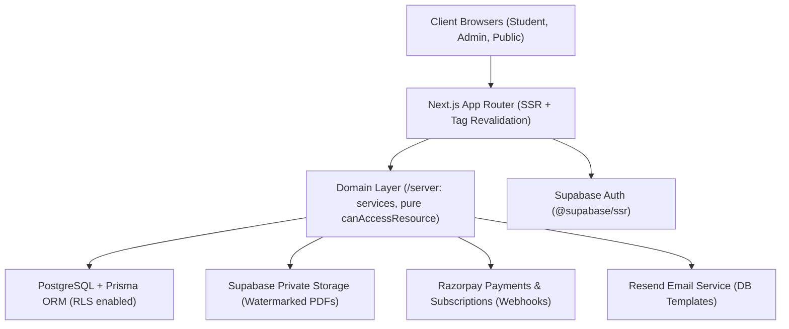

# EVOH Academy - Implementation Plan & Phased Roadmap

This implementation plan translates the **EVOH Academy PRD v2.0** into a phased, verification-driven execution strategy. Per the **Agent Execution Protocol (Section 33)**, development proceeds strictly in vertical slices across designated phases, with each phase culminating in a verification checkpoint (build, type check, lint, tests, responsive audit) and a phase report.

---

## 1. Architecture & Core Principles

### Architectural Guardrails:
1. **The Zero-Hardcoding Rule (PRD Sec 4)**: Every business string, curriculum node, pricing tier, tax rate, page block, and policy text is sourced from database models and configured via Admin CMS. Only UI chrome tokens (e.g. "Save", "Cancel") exist in code via an i18n message catalog.
2. **Dynamic Block Registry**: The homepage and CMS pages are dynamically assembled from typed `PageBlock` records validated by versioned Zod schemas.
3. **Decoupled Server Domain Layer (`/server`)**: Business logic (entitlement resolution, tax computation, discount application, order fulfillment) lives in pure, testable domain services. Route handlers and Server Actions remain thin controllers.
4. **Defense-in-Depth Authorization**: Centralized `can(user, permission, resource?)` helper checks granular permissions from `RolePermission` tables. Row-Level Security (RLS) is enabled on all tables as defense in depth.
5. **Deterministic Entitlements**: `canAccessResource(user, resource, now)` is a single, pure, table-tested decision engine evaluating Free status, explicit `Entitlement` records, and active `PlanEntitlementRule` sets.

---

## 2. Phased Roadmap & Task Breakdown

### Phase 0: Discovery & Project Foundations (Completed)
- [x] Inspect workspace and initialize foundational repository structure.
- [x] Record full PRD as [`docs/PRD.md`](file:///Users/saiyam/EVOH%20Academy/docs/PRD.md).
- [x] Establish Agent Execution Protocol in [`AGENTS.md`](file:///Users/saiyam/EVOH%20Academy/AGENTS.md).
- [x] Create [`docs/OPEN_DECISIONS.md`](file:///Users/saiyam/EVOH%20Academy/docs/OPEN_DECISIONS.md) capturing all 16 `[OWNER DECISION]` items and 7 `[LEGAL REVIEW]` items.
- [x] Draft Initial ERD in [`docs/ERD.md`](file:///Users/saiyam/EVOH%20Academy/docs/ERD.md).
- [x] Draft Design System & Token Strategy in [`docs/DESIGN_SYSTEM.md`](file:///Users/saiyam/EVOH%20Academy/docs/DESIGN_SYSTEM.md).

---

### Phase 1: Foundation, Infrastructure & Core DB (Active)
- **Tooling & Setup**:
  - Next.js (App Router, TypeScript strict mode), Tailwind CSS, Lucide icons, Motion for React.
  - Environment variable schema validation (`env.ts` via Zod).
  - Structured logging with Pino.
- **Database Architecture**:
  - Prisma schema with PostgreSQL models (integer paise currency, UUID/CUID PKs, soft-deletes, versioning fields).
  - Granular RBAC tables: `Role`, `Permission`, `RolePermission`.
  - Pure `can(user, permission, resource?)` authorization engine.
  - Idempotent seed script (`prisma/seed.ts`): roles, permissions, default policies (unreviewed), default resource types, feature flags, draft starter curriculum, default homepage blocks.
- **Auth Integration**:
  - Supabase Auth setup via `@supabase/ssr` with mirrored `User` table keyed by `authProviderId`.
  - Secure first-admin bootstrap CLI script (`npm run admin:create`).
- **Quality Gate**:
  - `npm run build`, `npm run lint`, `tsc --noEmit`, unit tests on `can()` and RBAC matrix.

---

### Phase 2: Dynamic CMS Core & Admin Shell
- **CMS Core**:
  - `SiteSetting` domain service & CSS variable injector (dynamic theme tokens: primary cobalt, navy, surface ivory, typography).
  - `NavItem` management service (hierarchical, role-aware navigation).
  - `PageBlock` registry: typed schema validation per block (`hero`, `class_selector`, `subject_feature`, `featured_resources`, etc.).
  - On-demand cache revalidation pipeline (`revalidateTag`).
- **Admin Shell**:
  - Responsive admin layout with permission-aware sidebar (`/admin`).
  - Read-only RBAC Permission Matrix viewer for `SUPER_ADMIN`.
  - Settings & Theme editor with live contrast validation (WCAG AA).
  - Homepage blocks editor with visual reordering and draft preview.
- **Quality Gate**:
  - Admin shell interactive test, block registry unit tests, build & lint verification.

---

### Phase 3: Public Site & Editorial Experience
- **Dynamic Public Pages**:
  - Block-driven homepage (`/`) supporting dynamic block reordering.
  - Class portals (`/classes`, `/classes/11`, `/classes/12`).
  - Subject and chapter dynamic routes (`/subjects`, `/subjects/[slug]`, `/chapters/[slug]`).
  - Catalog listings (`/notes`, `/notes/[slug]`, `/bundles`, `/bundles/[slug]`, `/free-resources`, `/pricing`).
  - Editorial & support pages (`/about`, `/blog`, `/blog/[slug]`, `/faq`, `/contact`, `/pages/[slug]`).
  - Legal policy pages (`/terms`, `/privacy`, `/refund-policy`, `/subscription-terms`, `/digital-delivery-policy`, `/cookie-policy`).
- **Search & SEO**:
  - Full-text search endpoint (`/api/search`) using Postgres full-text / trigram matching with debounce.
  - Dynamic `sitemap.xml`, `robots.txt`, and Open Graph metadata generation.
  - Zero dead-links check and responsive viewport validation (375, 768, 1024, 1440 px).
- **Quality Gate**:
  - Playwright visual snapshot check across viewports, SEO validation, link crawler.

---

### Phase 4: Auth Flow, Student Dashboard & Minor Protection
- **Auth Workflows**:
  - Email signup, login, password reset, session management.
  - Age-verification gate at registration (DPDP Act 2023 compliance).
  - Minor account `PENDING_GUARDIAN_CONSENT` state.
  - Tokenized guardian consent email dispatch and verification handler.
- **Student Dashboard (`/dashboard`)**:
  - Learning dashboard: greeting, class preference, continue reading, notifications.
  - Resource Library (`/dashboard/library`): owned notes, plan-included notes, version badges.
  - Purchases & Invoices (`/dashboard/purchases`, `/dashboard/purchases/[orderNumber]`).
  - Privacy and Data Rights Center (`/dashboard/privacy`): export personal data, deletion request.
  - Guardian view: read-only oversight of child purchases and consent status.
- **Quality Gate**:
  - Auth flow tests, minor gating integration tests, IDOR security tests on student endpoints.

---

### Phase 5: Notes Marketplace, Protected Delivery & Commerce
- **Asset Pipeline & Storage**:
  - Supabase Private Storage upload with MIME/magic-byte validation and size caps.
  - `ResourceVersion` tracking for non-destructive updates and rollback.
  - Dynamic server-side watermarking engine (student identity stamp).
  - Protected in-browser reader (`/dashboard/reader/[resourceId]`) & signed short-lived download URLs (`/api/downloads/[resourceId]`).
  - Abuse controls: `DownloadPolicy`, `DeviceLimitPolicy`, download rate-limiting, and audit logging.
- **Commerce & GST Invoicing**:
  - Cart and checkout pipeline with server-side price & tax calculation.
  - GST place-of-supply rules (intra-state CGST+SGST vs inter-state IGST).
  - Razorpay order creation, client checkout integration, webhook signature verification.
  - Idempotent fulfillment transaction: order status update, entitlement generation, coupon redemption.
  - Automated PDF tax invoice / bill of supply generation and email dispatch.
- **Quality Gate**:
  - Unit tests on tax math, coupon limits, watermarking, webhook idempotency; Razorpay test-mode transaction run.

---

### Phase 6: Subscriptions & Entitlements Engine
- **Relational Entitlements Engine**:
  - Implementation of `canAccessResource(user, resource, now)` evaluating Free rules, stored Entitlements, and active `PlanEntitlementRule` records.
  - Subscription selection storage (`SubscriptionSelection`) for Subject Pass tiers.
- **Razorpay Recurring Billing**:
  - Subscription lifecycle management: `created`, `authenticated`, `charged`, `pending`, `halted`, `cancelled`.
  - Fallback feature-flagging for recurring billing if provider KYC is pending.
  - Daily reconciliation background job.
- **Student Subscription Center**:
  - Manage subscription, tier upgrade/downgrade, renewal tracking, cancel at period end.
- **Quality Gate**:
  - 100% test coverage on `canAccessResource` table-driven test cases.

---

### Phase 7: Complete Admin CMS & Operational Tools
- **Content & Curriculum Management**:
  - Syllabi, subjects, chapters, topics CRUD with drag-and-drop reordering.
  - Resource and version management, preview generator, bulk status toggles.
  - Bundles and pricing managers.
- **Commerce & Support Administration**:
  - Orders, refunds, credit notes, and manual refund execution.
  - Coupon management (usage caps, validity periods, product eligibility).
  - Enquiries and support ticketing with staff internal notes.
  - Verified buyer review moderation queue.
- **Audit & Governance**:
  - Full `AuditLog` inspector with before/after state diffs (secrets redacted).
  - Webhook event log and failed job inspector with safe replay.
  - Settings backup/restore (JSON import/export).
- **Quality Gate**:
  - Admin permission boundary audit (ensuring editors/support cannot access financial/role controls).

---

### Phase 8: Hero 3D Scene, Visual Refinement & Performance Budget
- **Scientific Visual Identity**:
  - React Three Fiber / Drei lazy-loaded hero 3D scene (abstract molecular/orbital structure).
  - Automatic static SVG fallback on `prefers-reduced-motion`, save-data, or WebGL absence.
  - Framerate guard and intersection observer auto-pausing.
  - 2D SVG/Canvas scientific visualizations for Physics, Chemistry, and Mathematics subjects.
- **Performance Budget Optimization**:
  - Bundle size validation: homepage JS < 200 KB gzipped, 3D chunk < 250 KB gzipped.
  - Core Web Vitals checks: LCP < 2.5s, CLS < 0.1, INP < 200ms.
- **Quality Gate**:
  - Automated Lighthouse CI audit, axe accessibility pass (WCAG 2.2 AA).

---

### Phase 9: QA, Verification Suite & Production Readiness
- **Comprehensive Verification**:
  - End-to-end Playwright tests covering student signup, purchase, download, admin CMS updates.
  - Automated dead-link crawler across all routes in PRD Section 9.
  - Penetration testing checklist: CSRF, IDOR, SQL injection, XSS, rate-limiting.
  - Emergency runbook validation (`docs/RUNBOOK.md`): key rotation, webhook replay, maintenance mode.
  - Go-live blocker checklist review: verification of unreviewed legal/tax items.
- **Deliverables**:
  - Complete `README.md`, setup instructions, seed commands, admin bootstrap documentation, final verification report.
